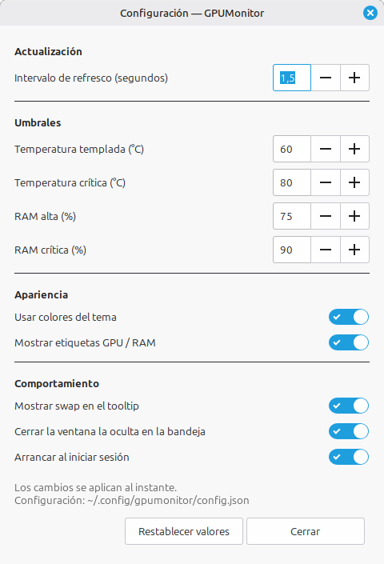

# GPUMonitor — Intel UHD 630 temperature + RAM in the Cinnamon panel

Hi everyone,

I'd like to share **GPUMonitor**, a small app for **Linux Mint 22.3 Cinnamon**
that shows the **Intel UHD Graphics 630** temperature and **RAM usage** right
in the panel, no extra window needed.

- Repository: https://github.com/shary-hh/gpumonitor
- Downloads (.deb and tar.gz): https://github.com/shary-hh/gpumonitor/releases
- License: MIT

Suggested Reddit title:
`GPUMonitor – GPU temp + RAM for Intel UHD 630 in the Cinnamon panel (Linux Mint 22.3)`

## Important note about the temperature

The UHD 630 **does not expose its own temperature sensor on Linux** (there is
no `i915` hwmon). That is why the `gputemperature@silentage.com` applet shows
`NaN °C`: there is no sensor to read. GPUMonitor uses the **CPU package
temperature** as an approximation (same die) and labels it clearly with `≈` in
CLI mode and “Aproximación” in the window. If the kernel ever exposes a real
sensor, the app detects and uses it automatically.

## Features

- GTK3 window with a large temperature readout, status colors and a sparkline.
- Tray icon with **`39° GPU | 34% RAM`** drawn inside the icon.
- Real GPU frequency and activity from **RC6** residency.
- Context temperatures: CPU package and PCH.
- RAM and swap usage.
- **Colors follow the active Cinnamon/GTK theme** (accent, panel text, warning
  and error colors).
- **Built-in settings**: interval, thresholds, labels, colors, swap,
  close-to-tray and autostart.
- CLI mode and JSON output.
- No `sudo` needed to read sensors, no daemons.

## Screenshots




## Installation

### .deb package (recommended)

```bash
sudo apt install ./gpumonitor_1.1.0_all.deb
```

Dependencies: `python3-gi`, `gir1.2-gtk-3.0`, `python3-cairo` and
`gir1.2-ayatanaappindicator3-0.1` (apt resolves them).

### From source, current user only

```bash
tar xzf gpumonitor-1.1.0.tar.gz
cd gpumonitor-1.1.0
./install.sh                # launcher and `gpumonitor` command
./install.sh --autostart    # also start at login
./install.sh --uninstall    # uninstall
```

## Usage

```bash
gpumonitor                 # window + tray
gpumonitor --settings      # window + settings
gpumonitor --cli           # live terminal output
gpumonitor --cli --once    # single reading
gpumonitor --json          # JSON for scripts
```

Settings also open from the gear button in the window or from **Configuración…**
in the tray menu.

If the panel icon looks too small, you can enlarge Cinnamon's right zone:

```bash
gsettings set org.cinnamon panel-zone-icon-sizes \
  '[{"panelId": 1, "left": 0, "center": 0, "right": 32}]'
```

Use `right: 24` to restore the default size.

## Tested on

- Linux Mint 22.3 Cinnamon (Zena)
- Kernel 7.0.0-43
- Intel UHD Graphics 630 (Coffee Lake GT2, `8086:3e92`, `i915` driver)
- Mint-Y-Dark-Aqua theme

## Feedback

Testing on other iGPUs, kernels or themes is welcome. If something fails,
please open a GitHub issue with:

```bash
gpumonitor --json
cat /etc/os-release | head -3
uname -r
```

Thanks!
