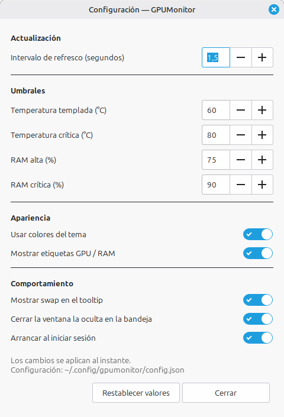
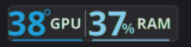
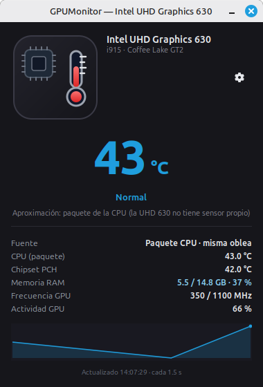

# GPUMonitor 1.1.0

Nueva **sección de configuración** integrada, con ajustes persistentes y
aplicación inmediata.

## Novedades

- Diálogo de configuración accesible desde:
  - el **engranaje** de la ventana,
  - el menú de la bandeja (**Configuración…**),
  - o `gpumonitor --settings`.
- **Intervalo de refresco** ajustable de 0,5 a 10 segundos.
- **Umbrales** de temperatura templada/crítica y RAM alta/crítica.
- **Mostrar etiquetas GPU/RAM**: al desactivarlo, el icono se compacta a
  `39° | 37%` y ocupa menos ancho.
- **Colores del tema** activables/desactivables (clásico verde/azul si se
  desactivan).
- Mostrar **swap** en el tooltip.
- **Cerrar la ventana la oculta en la bandeja**.
- **Arrancar al iniciar sesión** desde el propio diálogo.
- Los cambios se aplican al instante y se guardan en
  `~/.config/gpumonitor/config.json`.

## Instalación

### Paquete .deb

```bash
sudo apt install ./gpumonitor_1.1.0_all.deb
```

### Desde el código

```bash
tar xzf gpumonitor-1.1.0.tar.gz
cd gpumonitor-1.1.0
./install.sh
```

## Capturas







## Verificación

`SHA256SUMS` se adjunta a la release:

```bash
sha256sum -c SHA256SUMS
```

## Licencia

MIT © 2026 shary-hh.
